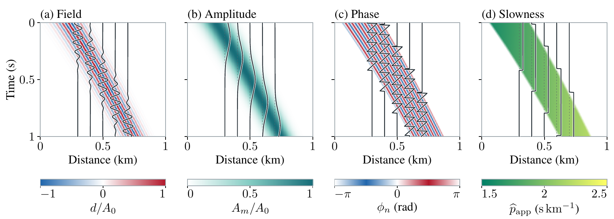
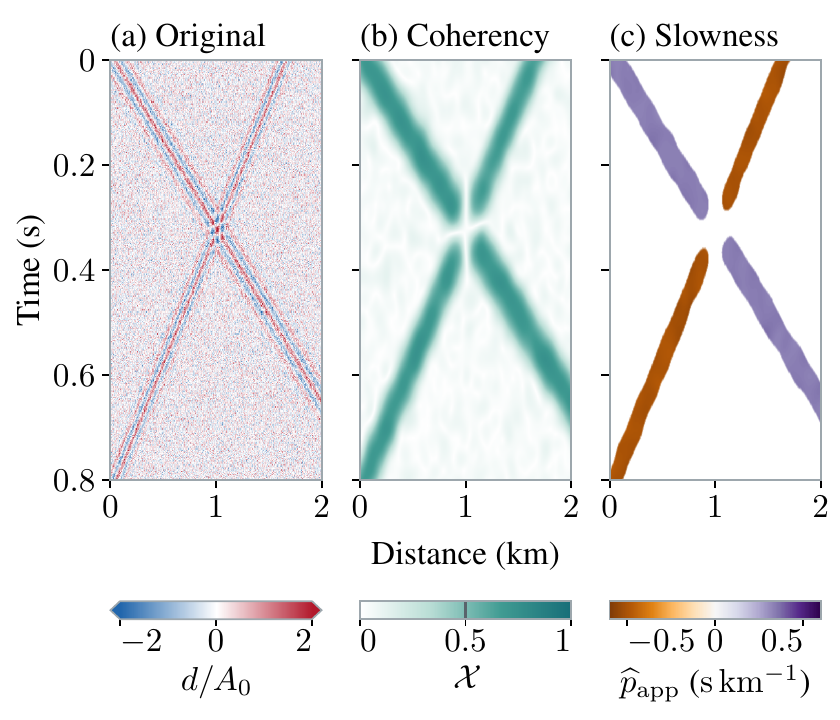
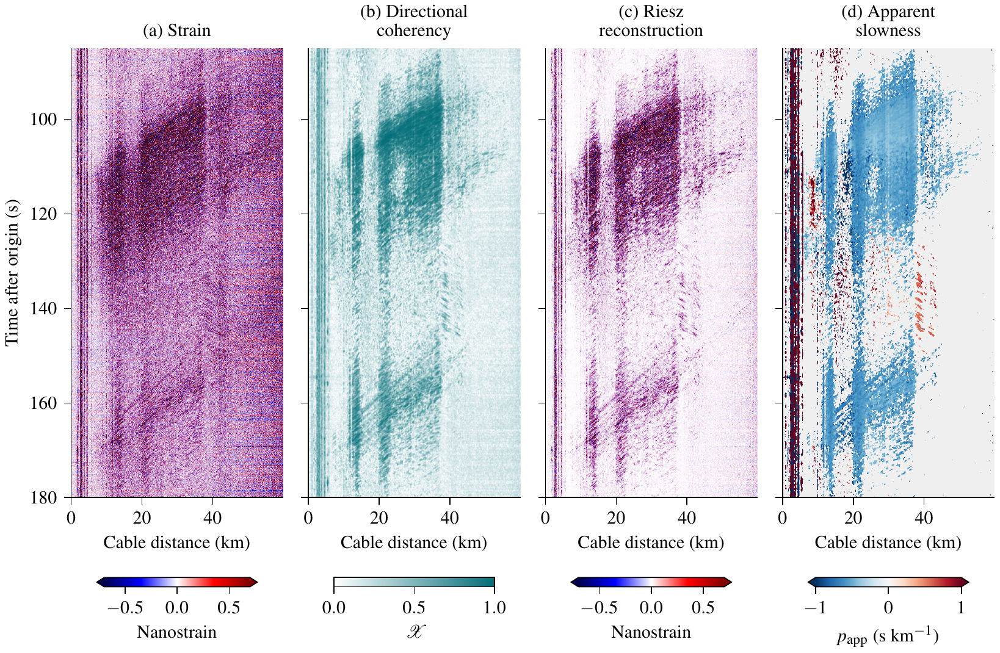
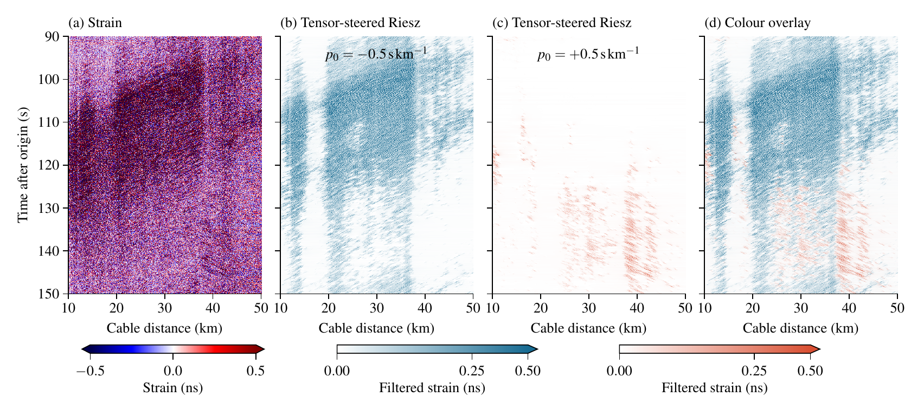

# RieszLab: A Python toolkit for monogenic analysis of spatio-temporal signals

RieszLab implements methods for describing wavefields through their monogenic amplitude, phase, orientation and
directional coherency. These complementary attributes have applications that include signal identification and enhancement, also supporting
tracking and propagation analysis. The examples use distributed acoustic sensing (DAS) recordings.



The monogenic amplitude follows the packet, the phase resolves its oscillations, and the orientation
gives the apparent slowness along the cable.

For detailed explanation on the quantities and calculations, read [paper]. 

Copyright 2026 Aleix Seguí Ugalde, University of Oxford.\
Contact: aleix.seguiugalde@eng.ox.ac.uk

## Getting started

Install from this folder with `python -m pip install -e .`.
NumPy and SciPy are required; `python -m pip install -e '.[plot,io,test]'`
adds optional plotting, HDF5 and tests.

Inputs are finite real **(channel, time)** arrays with uniform sampling.

```python
from rieszlab import GaussianTensorConfig, monogenic
from rieszlab.preprocessing import butterworth, remove_common_mode

x = butterworth(data, dt_s=0.01, band_hz=(3, 30))
x = remove_common_mode(x).data
result = monogenic(
    x, dx_m=10, dt_s=0.01,
    tensor=GaussianTensorConfig(sigma_space_m=90, sigma_time_s=0.09, tau=0.01),
)
p = result.slowness_s_per_km
```

The result provides `amplitude`, `phase_directional`, `orientation`, `coherence`
and slowness in s/m or s/km. The input and Riesz components are in
`result.monogenic`; tensor entries and eigenvalues are in `result.tensor`.

We use an averaging tensor to obtain robust estimates and to compute the directional coherency.
Omit the tensor, or pass `tensor=None`, for instantaneous attributes with
`coherence=None`. Change the averaging with
`result.with_tensor(GaussianTensorConfig(60, 0.05, tau=0.01))`.
This returns a new result sharing the original Riesz components, without
repeating the transform. `result.with_tensor(None)` removes the averaging.

## Main parameters

Both `dx_m` and `dt_s` are required. Their ratio defines the default space–time
metric that gives units to the computed slowness. For example, 10 m and 0.01 s give 1000 m/s. 
`reference_velocity_mps` can override this metric. Notice that this is a coordinate scale, not an assumed propagation velocity.

| Configuration | Main choices |
| --- | --- |
| `RieszConfig` | Metric, reflection padding (128 channels and 256 time samples per side), and precision (`float64` by default). |
| `GaussianTensorConfig` | Spatial and temporal Gaussian standard deviations, in metres and seconds. Scalars or profiles along each axis. |
| `SteeredTensorConfig` | Slowness in s/m and parallel/normal Gaussian standard deviations, in metres in the `(s,c*t)` plane. |
| `DirectionSelectionConfig` | Selected slowness, angular standard deviation in degrees, and coherency exponent. |

Both tensor configurations share `tau` (default 0) and `truncate` (default 4
standard deviations). `tau` provides a regularised coherency (see section 2.3 in the paper), and has squared signal-amplitude units and suppresses low-energy coherency.



Coherency is high along isolated arrivals and decreases where competing
directions overlap. Here, slowness is displayed where coherency is at least 0.5.

Orientation is axial, in radians from the spatial axis of `(s,c*t)`.
Apparent slowness is computed as $-\cos\theta/(c\sin\theta)$, positive for later arrivals
at greater distance. The directional is computed along the normal defined by this orientation.

Loading and analysis default to double precision. For lower memory use, choose
`read_hdf5(..., dtype="float32")` and `RieszConfig(dtype="float32")`.

## Enhancement and direction selection



Continuous coherency weighting enhances the T-wave trains. Input and enhanced
strain share the same scale; slowness comes from the input, with coherency ≥0.3.

```python
from rieszlab import (
    DirectionSelectionConfig, SteeredTensorConfig,
    enhance_coherent, enhance_directional,
)

enhanced = enhance_coherent(result)
steered = result.with_tensor(SteeredTensorConfig(
    slowness_s_per_m=-0.0005, sigma_parallel_m=300, sigma_normal_m=50, tau=0.01,
))
selected = enhance_directional(steered, selection=DirectionSelectionConfig(
    slowness_s_per_m=-0.0005, angular_sigma_degrees=10,
))
```

Steering rotates the averaging window, and direction selection weights the agreement
with a prescribed orientation.
The signal enhancement procedure weights all three monogenic components and reconstructs the scalar
field in the least-squares sense. To use your own `weights` in [0,1], on the
same (channel, time) grid:

```python
from rieszlab import reconstruct
enhanced = reconstruct(result.monogenic, weights=weights)
```

The reconstructed field is `enhanced.data`; `enhanced.weights` records the weights.
A scalar or broadcastable array is also accepted, and no tensor is required.



The ±0.5 s/km values prescribe the centre of the selections and are not fitted estimates.
Coloured panels show the positive lobes of the oscillations.

Use enhancement for visualisation or downstream analysis. 
Estimate slowness on the input field.

## Examples

The four Alboran examples demonstrate enhancement, cycle association, direction
fitting and direction selection. They illustrate the workflows rather than
reproduce the paper figures exactly.

```bash
export MPLBACKEND=Agg
alboran_file=/path/to/7M_S_20231005-090045.h5

python examples/01_enhancement.py --input "$alboran_file" --bad-channels 1654 1655 --plot-time 90 180
python examples/02_cycle_association.py --input "$alboran_file" --bad-channels 1654 1655
python examples/03_direction_fit.py --input "$alboran_file" --bad-channels 1654 1655 --geometry /path/to/cable.txt
python examples/04_direction_selection.py --input "$alboran_file" --bad-channels 1654 1655
```

These examples use 3–30 Hz filtering and spatial-median common-mode subtraction.
They process the full loaded record before display cropping, which can require
several GB. Sampling comes from HDF5 metadata or `--dx-m`/`--dt-s`; times are
record-relative unless `--origin-utc` is supplied. Alboran amplitudes are nanostrain.
The listed bad channels apply only to this October recording: they are interpolated
before analysis and excluded from associations.

Association follows phase crossings using orientation and ranks cycles by
waveform power. `--cycles`, `--nonconsecutive` and `--min-cycles` control selection;
association and summary coherency gates are separate. Run each script with
`--help` for its processing and display options.

Direction fitting needs a geometry file with one header and columns
`distance_m east_m north_m up_m`; `--geometry-lonlat` accepts longitude/latitude
instead of east/north. Fits assume zero vertical slowness and use Huber loss by
default. Bootstrap intervals are conditional on the selected observations and
model, not source-location errors.

For small synthetic demonstrations and tests:

```bash
python examples/basic_analysis.py --no-plots
python examples/adaptive_packets.py
python -m pytest -q
```

Additional tools cover Ricker bands and geometry-adaptive averaging. 
Function docstrings describe their parameters and assumptions.

Our method is descibed in paper [paper].

The tensor formulation is inspired from: Unser, Sage & Van De Ville (2009), *Multiresolution monogenic
signal analysis using the Riesz–Laplace wavelet transform*, IEEE TIP 18, 2402–2418.
